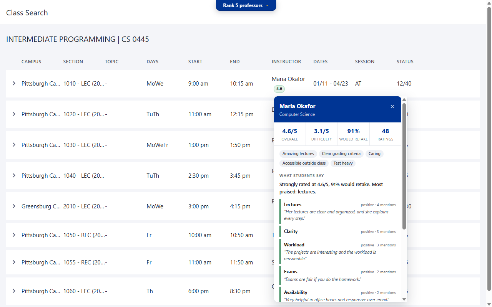
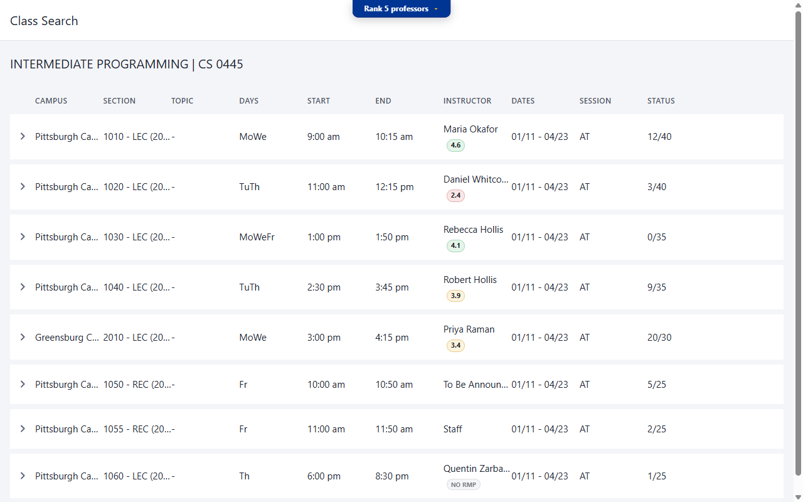

# Professor Ratings for Pitt

Shows RateMyProfessors ratings next to each instructor in Pitt's class search,
with an on-device AI summary of student comments when you click through.





Both pictures are from the stand-in page, so the names are invented.

A tab at the top of the page ranks every professor in the current results,
best first. Lookups cover the regional campuses as well as Pittsburgh, because
RateMyProfessors lists each campus as its own school.

## Install

1. Clone or download this repo somewhere permanent (the folder must stay put).
2. Go to `chrome://extensions`.
3. Turn on **Developer mode** (top right).
4. Click **Load unpacked** and select this folder.
5. Open the class search, run a search, and badges should appear in the
   INSTRUCTOR column.

## If no badges appear

Open the toolbar popup and click **Point at the instructor field**, then click
an instructor name once. It derives a CSS selector, saves it, and reloads.
That selector is used from then on.

If that doesn't work either, turn on **Settings → Log detection details to the
console**, reload, and check DevTools for `[prb]` lines.

## How it works

- `src/content.js` runs on the class search page. It finds instructor cells
  using six strategies in order (saved selectors, table column header, ARIA
  grid, label/value pairs, class-name matching, and geometric column
  alignment), then injects a badge per name and watches for re-renders.
- `src/background.js` is the service worker. It parses names, queries
  RateMyProfessors, scores candidates, dedupes in-flight requests, rate-limits
  to 6 concurrent, and caches everything.
- `src/offscreen.js` hosts the Qwen2.5-0.5B model. It lives in an offscreen
  document because MV3 service workers get killed and loading a model is slow,
  and it closes itself after three idle minutes to give the memory back.
  Summaries are generated only when you open a panel, never on page load.

Nothing leaves your machine except the RateMyProfessors lookup itself.

## Summaries

Every number in the panel (aspect sentiment, per-course averages, trend,
quotes) is computed locally in `src/lib/summarize.js` and is always exact.
The summary setting only decides whether a language model rewrites those figures
as a readable paragraph. A model is never asked to read raw reviews, because at
these sizes they are unreliable at extraction but adequate at rephrasing.

Summaries are written by **Qwen2.5-0.5B** running locally through WebGPU. The
model is a ~790 MB one-time download and works offline afterwards. If WebGPU
isn't available, or you turn summaries off in Settings, you still get the
statistics, aspect breakdown, per-course figures, and verbatim quotes. Those
are always computed locally and never depend on a model.

The model download is never automatic. Open the toolbar popup and click
**Download model**; progress appears there. Weights come from Hugging Face and
are cached by the browser afterwards.

### Vendored runtime

MV3 forbids remote code, so the ONNX runtime ships in `vendor/`:

- `transformers.min.js` (~560 KB)
- `ort-wasm-simd-threaded.asyncify.mjs` (~47 KB)
- `ort-wasm-simd-threaded.asyncify.wasm` (~24 MB)

To refresh them:

```
npm install --no-save --ignore-scripts @huggingface/transformers@4.2.0
cp node_modules/@huggingface/transformers/dist/transformers.min.js vendor/
cp node_modules/onnxruntime-web/dist/ort-wasm-simd-threaded.asyncify.mjs vendor/
cp node_modules/onnxruntime-web/dist/ort-wasm-simd-threaded.asyncify.wasm vendor/
```

`transformers.web.min.js` from the same package is the build for bundlers and
will not load in an extension page.

`--ignore-scripts` matters: `onnxruntime-node` has a postinstall that downloads
native binaries you don't need for a browser extension.

Threading is pinned to one worker because SharedArrayBuffer needs cross-origin
isolation that an offscreen document can't declare. WebGPU carries the compute,
so this costs little.

The licenses for both runtimes are in `vendor/LICENSES.txt`.

## Security posture

- Runs only on the class-search/catalog pages (`WEBLIB_HCX_CM` path); the
  browser blocks it everywhere else on the portal, including enrollment and
  grades.
- Read-only on the page: reads instructor names, appends badges, nothing else.
- Network access is limited to RateMyProfessors and Hugging Face.

## Scope

Runs only on the class search / catalog at
`pitcsprd.csps.pitt.edu/psc/pitcsprd/EMPLOYEE/SA/s/WEBLIB_HCX_CM.H_CLASS_SEARCH...`.
That page is a single-page app. A search fetches its results in place and the
document never reloads, so the content script starts once and watches for the
table to re-render.

## Development

```
npm install    # jsdom, for the detection tests
npm test
npm run e2e    # loads the extension into headless Chrome against a stand-in class search
npm run demo   # opens that stand-in in a normal Chrome window, to click through by hand
```

`npm run e2e -- --screenshots docs` regenerates the screenshots.

The real class search is public and opens without a login. I still use
`npm run demo` to click through the extension, because by default it needs no
network and every name on it is invented. The page it opens is a stand-in shaped like the
real results table, served at the real address, and the RateMyProfessors
answers are canned. With `-- --live` the page lists instructors from the unit
tests and the lookups go to the real site. The demo keeps its Chrome profile in
the temp folder so a downloaded model is still there next time, and
`-- --fresh` wipes it.

## Known limits

- RateMyProfessors has no public API. This uses the endpoint their own site
  calls. If they change it, `src/lib/rmp.js` is the only file to touch.
- Name matching is conservative. When two professors share a surname and the
  page only gives an initial, the badge is marked low confidence with a dashed
  border rather than guessing.
